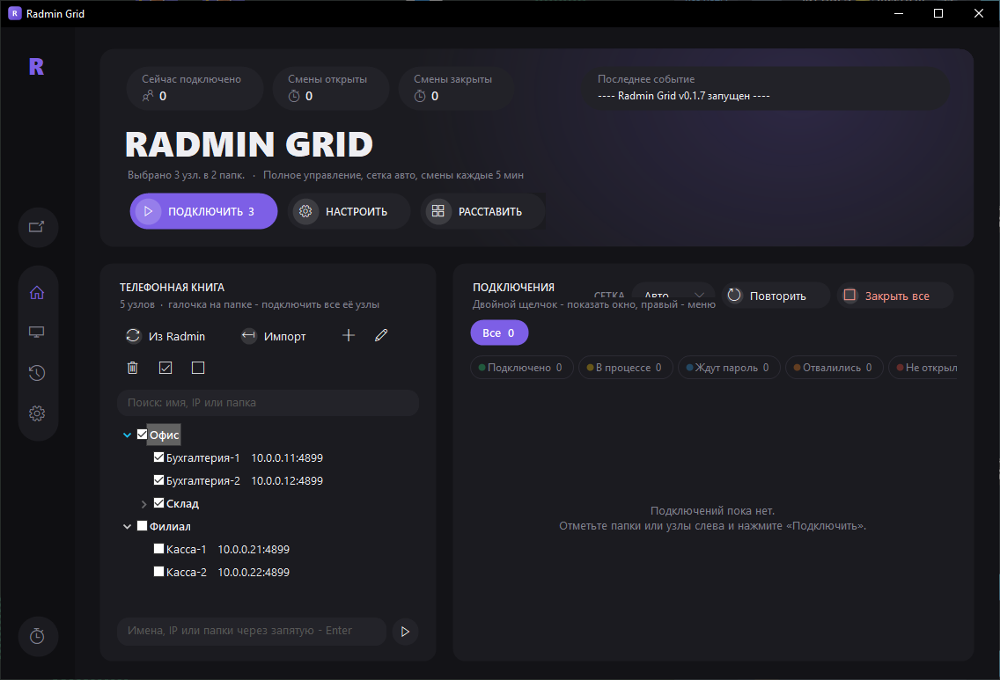
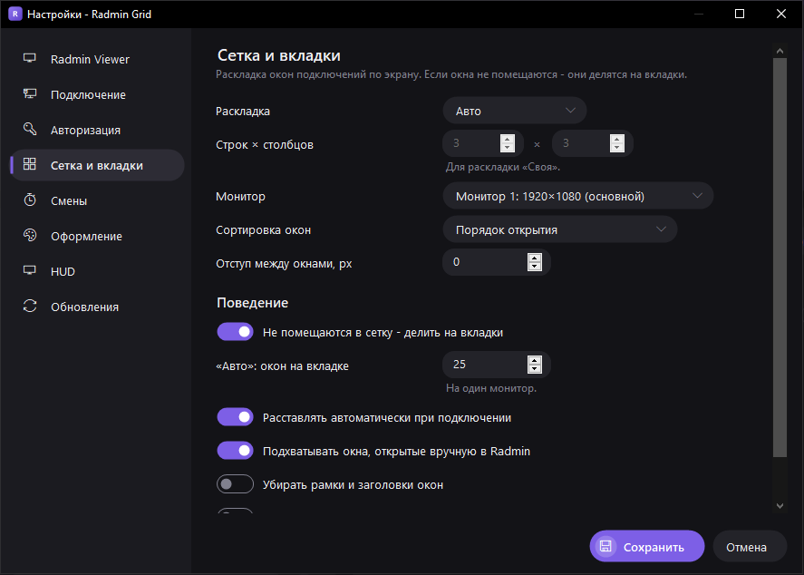
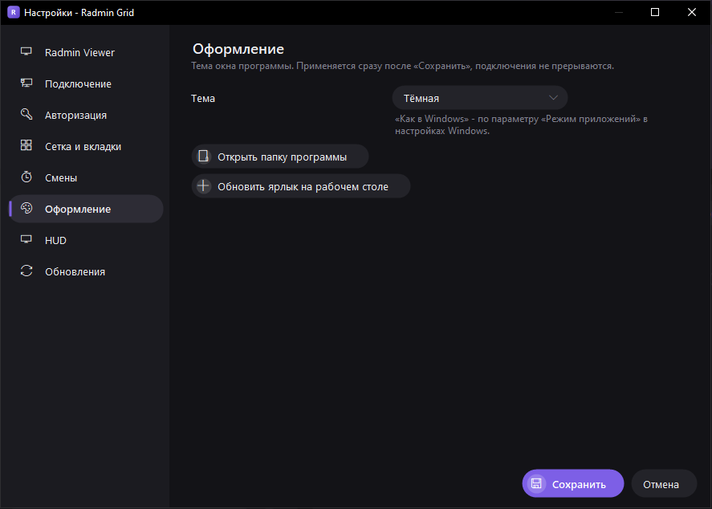
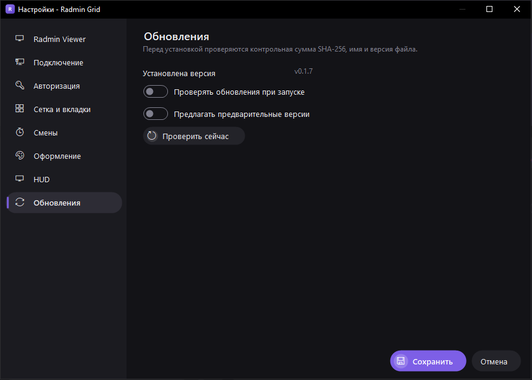

# Radmin Grid

[](https://github.com/barnibeats/RadminGrid/actions/workflows/build.yml)
[](https://github.com/barnibeats/RadminGrid/releases/latest)

Portable-оболочка для **Radmin Viewer 3**. Программа массово подключается к узлам, сама вводит логин и пароль, раскладывает окна по сетке и показывает статусы в HUD. Права администратора не нужны.

- один файл `RadminGrid.exe`, без установки;
- Windows 10 и 11, .NET Framework 4.x (уже есть в системе);
- обновляется сама из [релизов GitHub](https://github.com/barnibeats/RadminGrid/releases).

## Установка

1. Скачайте `RadminGrid.exe` со страницы [последнего релиза](https://github.com/barnibeats/RadminGrid/releases/latest).
2. Положите его в любую папку, куда у вас есть права на запись, например `D:\Tools\RadminGrid\`.
3. Запустите. Настройки и журнал появятся рядом с exe.

Контрольная сумма лежит в релизе в файле `SHA256SUMS.txt`. Проверить вручную:

```powershell
Get-FileHash .\RadminGrid.exe -Algorithm SHA256
```

## Обновления

Программа проверяет наличие новой версии при запуске (в фоне, работу не прерывает) и по кнопке **Настройки → Обновления → «Проверить сейчас»**.

Когда выходит новая версия, появляется окно с описанием изменений и тремя вариантами: «Установить и перезапустить», «Позже», «Пропустить версию».

Как проходит установка:

1. `RadminGrid.exe` из релиза скачивается рядом с программой во временный файл.
2. Проверяются:
   - **SHA-256** - по полю `digest`, которое GitHub считает сам, или по `SHA256SUMS.txt` из релиза. Релиз без контрольной суммы не устанавливается;
   - **имя сборки** - файл должен быть Radmin Grid;
   - **версия** - версия файла должна совпадать с тегом релиза.
3. Программа закрывается (как обычно спрашивает, закрыть ли открытые подключения), работающий exe переименовывается в `RadminGrid.exe.old`, новый встаёт на его место и запускается.
4. Новая версия дожидается выхода старой и удаляет `RadminGrid.exe.old`. Если заменить файл не удалось, прежний exe возвращается на место.

| Настройка | Что делает |
|---|---|
| Проверять обновления при запуске | Включено по умолчанию. При запуске с `/autoconnect` новая версия только отмечается в журнале, окно не показывается |
| Предлагать предварительные версии | Учитывать релизы с пометкой pre-release (теги вида `v0.2.0-beta`) |

Если папка программы только для чтения, автообновление невозможно - программа сообщит об этом. Токены и учётные данные для обновлений не нужны.

## Сборка

Запустите `build.bat`. Сборка идёт штатным `csc.exe` из .NET Framework 4.x, который есть в Windows 10 и 11; Visual Studio и SDK не нужны. На выходе получается один файл `RadminGrid.exe`.

Каждый push в `main` собирается на GitHub Actions ([build.yml](.github/workflows/build.yml)), exe доступен в артефактах сборки.

### Выпуск новой версии

1. Поднимите версию в [src/AssemblyInfo.cs](src/AssemblyInfo.cs) - это единственное место, где она задаётся.
2. Добавьте раздел `## [X.Y.Z]` в [CHANGELOG.md](CHANGELOG.md) - он станет описанием релиза.
3. Закоммитьте и поставьте тег:

   ```bash
   git commit -am "Версия 0.1.5"
   git tag v0.1.5
   git push origin main v0.1.5
   ```

[release.yml](.github/workflows/release.yml) сверит тег с версией в коде, соберёт exe, посчитает `SHA256SUMS.txt` и опубликует релиз. Тег с дефисом (`v0.2.0-beta`) публикуется как предварительная версия. Через несколько минут установленные копии предложат обновиться.

## Интерфейс



Оформление в стиле игровых лаунчеров (фиолетовый акцент, кнопки-«таблетки»). Тема - тёмная, светлая или «как в Windows» (Настройки → Оформление, там же кнопки «Открыть папку программы» и «Создать ярлык на рабочем столе»); меняется сразу, без перезапуска и без обрыва подключений. HUD всегда тёмный - он лежит поверх окон подключений.

- **Панель иконок слева:** запустить Radmin, главная, HUD, журнал, настройки; внизу - «Проверить смены сейчас».
- **Баннер:** статистика (подключено, проблемы, смены открыты и закрыты), последнее событие и кнопки «Подключить», «Настроить», «Расставить».
- **Телефонная книга:** поиск по имени, IP или папке, галочки на папках и узлах, быстрый ввод адресов.
- **Подключения:** вкладки окон, счётчики-фильтры и список, где у каждого узла статус, номер смены, адрес и вкладка.
- **Настройки** открываются отдельным окном с разделами: Radmin Viewer, подключение, авторизация, сетка и вкладки, смены, оформление, HUD, обновления.

| Сетка и вкладки | Оформление | Обновления |
|---|---|---|
|  |  |  |

## Хранение данных

| Что | Где |
|---|---|
| Настройки, путь к Radmin, список узлов | `RadminGrid.settings.xml` рядом с exe. Если папка только для чтения - `%APPDATA%\RadminGrid\` |
| Журнал | `RadminGrid.settings.log` там же |
| Пароль | Шифруется DPAPI под текущего пользователя Windows. На другом ПК его нужно ввести заново. Шифрование можно отключить, тогда пароль хранится в base64, это небезопасно |

В реестр и в `HKLM` программа ничего не пишет.

## Порядок работы

1. **Radmin Viewer** - путь указывается кнопкой «Обзор…» или «Найти» и сохраняется. Автопоиск проверяет папку программы, соседние папки, `Program Files (x86)\Radmin Viewer 3` и путь уже запущенного Radmin.
2. **«⟳ Считать из Radmin»** - программа открывает Radmin, если он ещё не запущен, и обходит дерево папок через UI Automation.
   - Чтобы прочитать адреса и порты, включите в Radmin вид **«Вид → Таблица»** с колонками «Компьютер / Адрес / Порт».
   - Узлы без адреса подключаются через телефонную книгу.
3. Отметьте узлы или целые папки галочками и нажмите **«▶ Подключить отмеченные»**. Второй вариант - поле быстрого выбора: имена, IP-адреса или пути папок через запятую, например `Blabla_01/blabla01 blabla, 192.161.1.2`.
4. **Способы подключения:**

   | Способ | Как работает |
   |---|---|
   | Командная строка | `Radmin.exe /connect:адрес:порт` плюс `/noinput` для режима «просмотр» и `/stretch` для масштабирования. Каждое подключение - отдельный процесс, статус отслеживается по PID. Самый надёжный вариант |
   | Через телефонную книгу | Программа раскрывает папки в окне Radmin, выделяет узел, выбирает режим кнопкой на панели и нажимает Enter. При этом используются учётные данные, сохранённые в Radmin |

5. **Автоввод логина и пароля.** Программа находит окно входа Radmin, заполняет поля и нажимает OK. Если пароль запрашивается повторно, узел получает статус «Ошибка входа», а поля остаются для ручного ввода. Так программа не зацикливается на неверном пароле.
6. **Сетка.**
   - Раскладки: «Авто», 2×2, 3×3, 4×4 и другие, «Своя» - любое число строк и столбцов.
   - Можно выбрать один монитор или все сразу, задать отступы, убрать рамки окон и занять область панели задач.
   - Программа учитывает DPI каждого монитора (Per-Monitor V2), поэтому на 4K с масштабом 150–200% окна встают точно в пиксели.
   - Если окон больше, чем ячеек, лишние окна идут по кругу и перекрываются.
7. **HUD** - полупрозрачная панель поверх всех окон. Её можно перетаскивать за шапку.
   - Счётчики: подключено, в процессе, ждут пароль, отвалились, не открылись. Щелчок по счётчику оставляет в списке только эту группу, повторный щелчок показывает всё.
   - Список прокручивается колесом мыши или полосой справа. Внизу видно, какие строки показаны, например «1–19 из 68».
   - Размер меняется за любой край или правый нижний угол и запоминается. Пункт меню «Высота по содержимому» возвращает автоподгонку.
   - Кнопка «–» или двойной щелчок по шапке сворачивают HUD до одной строки со счётчиками.
   - Двойной щелчок по строке показывает окно подключения. Правый щелчок открывает меню: переподключить, отключить, убрать из списка.

**Статусы узлов:**

| Статус | Когда ставится |
|---|---|
| Подключено | Открылось окно подключения |
| Отвалилось | Окно закрылось, процесс завершился, или Radmin сообщил о потере связи |
| Не открылось | Ошибка Radmin, таймаут, или процесс завершился без окна |
| Недоступен | Порт не отвечает при предварительной проверке |
| Ошибка входа | Неверный логин или пароль |

## Вкладки

Если окна не помещаются в сетку, они делятся на вкладки по размеру сетки. Например, 60 подключений в сетке 4×5 дают 3 вкладки по 20 окон. Включается галочкой «Не помещаются в сетку - делить на вкладки» в блоке «Сетка окон». В режиме «Авто» на вкладке не больше 25 окон на монитор.

- **Текущая вкладка** разложена по сетке. Окна остальных вкладок убраны за край экрана, но не свёрнуты. Поэтому переключение мгновенное, а номер смены читается и у скрытых окон.
- **Переключение:**
  - вкладки «Все · Вкладка 1 · Вкладка 2…» над списком подключений на главном экране;
  - кнопки ◀ ▶ в главном окне;
  - сочетания клавиш, которые работают из любой программы: Ctrl+Alt+← / →, Ctrl+Alt+1…9.
- **Двойной щелчок по подключению** (в списке или в HUD) переключает на его вкладку.
- **Фиолетовая точка на вкладке** означает, что на ней есть закрытая смена.
- **Поднятие окон.** При переключении вкладки её окна поднимаются поверх остальных программ. Новые подключения раскладываются, не выдёргивая окна поверх того, с чем вы работаете.

## Номер смены

Программа читает строку статуса «Зміна №3292 (Оператор 6)» из окон подключений: число означает, что смена открыта, 0 или «закрита» - что закрыта. Номер показывается в строке HUD, в шапке HUD есть квадратные счётчики-фильтры «смена открыта» и «смена закрыта», изменения пишутся в журнал.

- **Как читается.** Программа делает локальный снимок окна Radmin (PrintWindow) и распознаёт его встроенным OCR Windows 10 (ru/en). На удалённый компьютер не уходит ни щелчков, ни клавиш.
- **Мелкие окна.** Если окно уже 1000 px, на время снимка (~1 с) оно увеличивается под всеми остальными окнами, поэтому этого не видно, и затем возвращается на прежнее место и на прежнее место в стопке окон. Окно, с которым вы сейчас работаете, не трогается - оно снимается как есть. Можно отключить в блоке «Смены».
- **Надёжность.** Строка распознаётся дважды, при увеличении ×2 и ×3. Номер принимается, только если результаты совпали, иначе в HUD стоит «?», а причина видна в подсказке.
- **Настройки** в блоке «Смены»: включение, интервал в минутах, кнопка «Проверить смены сейчас» (она же есть в меню HUD).
- **Ограничения.** Свёрнутое окно снять нельзя. Если строка статуса не попадает в видимую часть окна, номер не прочитается.

## Обработка ошибок

| Ситуация | Что делает программа |
|---|---|
| Radmin Viewer уже запущен | Предлагает выбор: использовать запущенный, перезапустить или отменить. Предупреждает, если это экземпляр из другой папки |
| Radmin запущен с правами администратора, а Radmin Grid - без них | Windows блокирует управление таким окном (UIPI), программа выводит понятное сообщение |
| Узел недоступен | Порт проверяется до запуска, окна ошибок Radmin закрываются автоматически, по желанию включается автопереподключение: число попыток и пауза настраиваются |
| Radmin Grid уже запущен из этой папки | Второй экземпляр не откроется |

## Ключи запуска

`RadminGrid.exe /autoconnect` - подключиться к отмеченным узлам сразу после запуска. Удобно для ярлыка.

## Тестовый эмулятор

`test\FakeRadmin.cs` - эмулятор Radmin Viewer для проверки без реальных серверов. В нём есть окно входа с логином `admin` и паролем `test123`, узел с отказом `10.0.0.99` и узел, который обрывается через 8 секунд (адрес оканчивается на `.13`).
